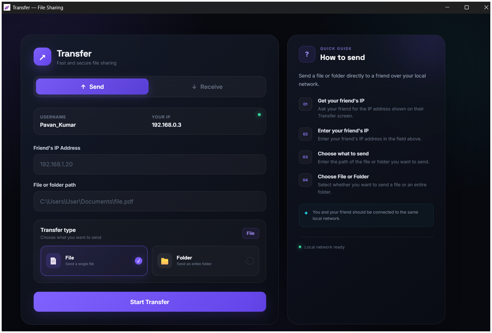
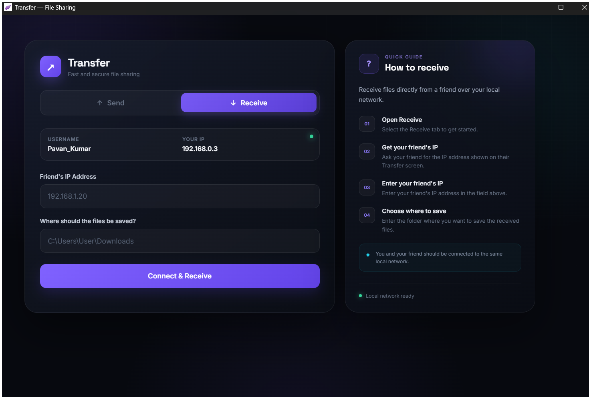

# Transfer

A simple desktop application for transferring files and folders between devices over a local network.

The application uses a **TCP connection** to transfer files directly from one device to another. No cloud server is involved, and an internet connection is not required.


## Screenshots

### Send

<p align="center">
  
</p>

### Receive

<p align="center">
  
</p>


---

## How It Works

Both devices need to be connected to the **same Wi-Fi network**.

One device acts as the **Sender** and the other acts as the **Receiver**.

    SAME LOCAL NETWORK
           Wi-Fi
             │
      ┌──────┴──────┐
      │             │
      ▼             ▼
    ┌──────────┐  ┌──────────┐
    │  SENDER  │  │ RECEIVER │
    │          │  │          │
    │ Select   │  │ Select   │
    │ file or  │  │ save     │
    │ folder   │  │ location │
    └────┬─────┘  └────▲─────┘
         │             │
         │ TCP         │
         └─────────────┘
               │
               ▼
        Direct file transfer
         between devices

The sender connects to the receiver using the receiver's **local IP address**.


The internet is not involved. The Wi-Fi network simply allows the two devices to communicate with each other locally.


## Getting Started

### Using the Ready-to-Use Application

If you have the `Transfer.exe` file, you can use the application without installing Python or setting up the project manually.

### 1. Connect Both Devices

Connect the sender and receiver to the **same Wi-Fi network**.

For example:

    Laptop ───── Same Wi-Fi ───── Desktop

### 2. Start the Application

Open:

    Desktop Application/
    └── Transfer.exe

Run the application on both devices.

If Windows Firewall asks for permission, allow the application to communicate on your **Private network**.

### 3. On the Receiving Device

Select the **Receive** option.

Choose the folder where you want the received files to be saved.

Keep the application open while waiting for the sender.

### 4. On the Sending Device

Select the **Send** option.

Choose what you want to send:

- A file
- A folder

Enter the receiver's **local IP address** and start the transfer.

### 5. Transfer

Once the TCP connection is established, the file is transferred directly from the sender to the receiver.

During the transfer, the application displays information such as:

- Current file
- Transfer progress
- Transfer speed
- Amount of data transferred
- Estimated time remaining

Once the transfer is finished, the application shows that the transfer has been completed.

## Finding the Receiver's IP Address

The receiver needs to provide its local IP address to the sender.

It will usually look something like:

    192.168.1.25


The exact address depends on the network.

Both devices must be connected to the same Wi-Fi network for the local IP address to work.

## Running the Project from Source

If you want to run the project from source instead of using `Transfer.exe`, install Python first.

Open a terminal inside the `Backend` folder and install the required packages:

    pip install -r requirements.txt

Then start the backend:

    python main.py

The application uses two ports:

| Service | Port |
|---|---:|
| API | `8000` |
| File Transfer | `5000` |

If you're using the ready-to-use `Transfer.exe`, you normally don't need to configure these ports manually.

## What Can Be Transferred?

The application supports both individual files and complete folders.

For example:

- Documents
- Photos
- Videos
- Music
- ZIP files
- Complete folders
- Other files stored on your device

Large files can also be transferred while the application keeps track of the transfer progress.

## Important

### Both Devices Must Be on the Same Network

This is the most important requirement.

**Works:**

    Laptop ───── Wi-Fi ───── PC
                 │
            Same Network

**Does Not Work Directly:**

    Laptop ── Wi-Fi A       Wi-Fi B ── PC

If the devices are connected to different networks, the sender normally cannot connect directly to the receiver using its local IP address.

### Windows Firewall

If the devices cannot connect, check Windows Firewall.

When Windows asks whether to allow the application through the firewall, allow it for **Private networks**.


## Project Structure

```
   File Transfer/
│
├── Assets/
│   └── logo.ico
│
├── Backend/
│   ├── main.py
│   └── requirements.txt
│
├── Desktop Application/
│   └── Transfer.exe
│
└── Frontend/
    ├── index.html
    ├── script.js
    └── style.css

```


## Quick Summary

    1. Connect both devices to the same Wi-Fi network
                         ↓
    2. Open Transfer.exe on both devices
                         ↓
    3. Start Receive on the receiving device
                         ↓
    4. Select a file or folder on the sending device
                         ↓
    5. Enter the receiver's local IP address
                         ↓
    6. TCP connection is established
                         ↓
    7. File transfers directly between the devices
                         ↓
    8. Transfer complete

That's it.

**No internet connection is required.**

**No cloud storage is used.**

**No cable is required.**

Files are transferred directly between the two devices over the local network using a TCP connection.
